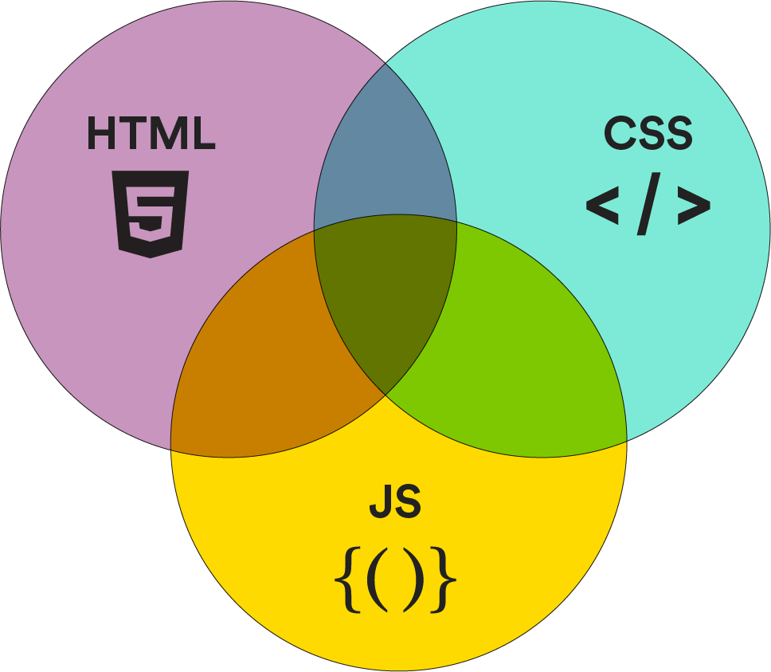
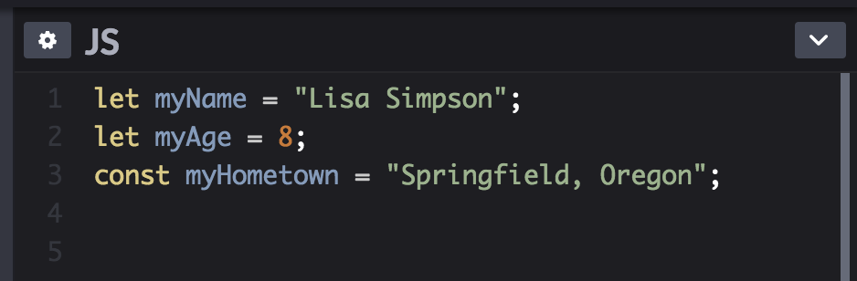

<textarea id="source">

<h1 class="slide-header">Introduction to JavaScript</h1>

<span id=time-estimate class="color-grey-500">30 mins</span>

<p id="lesson-description">
Along with HTML and CSS, JavaScript powers the web as we know it. You’ve been using it for years, maybe without even realizing it. Your bank’s website, search engines, social media sites, certain mobile apps — they all use JavaScript to power engaging interactions, enhance the user experience, and create intuitive interfaces. In this lesson, you’ll learn about the role JavaScript plays in modern web applications.
</p>

<h5 id="topics-header" class="color-grey-500">Topics</h5>

JavaScript and the Modern Internet

<hr>

JavaScript Syntax

<hr>

JavaScript Data Types

<hr>

<a href="./assets/introduction_to_javascript_study_guide.pdf" target="_blank" download="introduction_to_javascript_study_guide.pdf" class="ant-btn" data-trackable="true" data-track-category="study guide" data-track-section="lesson page" data-track-action="download study guide"><span role="img" class="anticon"><svg viewBox="0 0 16 16" width="1em" height="1em" fill="currentColor" aria-hidden="true" focusable="false" class=""><g class="download_svg__nc-icon-wrapper"><path d="M8 12c.3 0 .5-.1.7-.3L14.4 6 13 4.6l-4 4V0H7v8.6l-4-4L1.6 6l5.7 5.7c.2.2.4.3.7.3z"></path><path data-color="color-2" d="M1 14h14v2H1z"></path></g></svg></span><span> Download Study Guide</span></a>

---

<h1 class="slide-header">Learning Objectives</h1>

<p>By the end of this lesson, you'll be able to:</p>

<ul>
  <li>Identify how and why JavaScript is used in modern web development.</li>
  <li>Write variables with correct JavaScript syntax.</li>
  <li>Combine strings of data using concatenation.</li>
</ul>

---

<h1 class="slide-header">Meet Javascript</h1>

**Meet JavaScript**

JavaScript (JS) is a programming language that brings interactivity to websites and other digital experiences. Whenever you see animations, interactive buttons, form validations, or dynamic content updates on a webpage, JavaScript is working behind the scenes. In fact, this entire site is powered by JavaScript!

JavaScript was created by **Brendan Eich** in 1995 and quickly became a fundamental building block of the web. Over the years, it has evolved significantly and is now supported by all major web browsers. While it originally ran only in web browsers, JavaScript can now be used on the back-end as well, thanks to technologies like **Node.js**.

**Java vs. JavaScript**

Despite the similarity in names, **Java and JavaScript are completely different languages**:

- **Java** is a general-purpose programming language often used for back-end development, mobile apps, and enterprise software.
- **JavaScript** was originally designed for web browsers to create interactive web pages, but it has expanded to power both front-end and back-end applications.

So, don’t let the name fool you—learning JavaScript does not mean learning Java!


_This pretty animation is powered by JavaScript. You can read about how it was put together over at_ <a href="https://hackernoon.com/javascript-promises-for-animation-sequences-e31873493d49" target="_blank" rel="noreferrer noopener">_Hacker Noon_</a>.

---

<h1 class="slide-header">HTML + CSS + JavaScript = Front-End Magic</h1>

The web started as a **text-only format**, with early websites displaying just plain text and hyperlinks. Over time, web technologies evolved to allow for more visually appealing and interactive experiences. **JavaScript** emerged to add interactivity, something that HTML and CSS alone could not achieve.

**The Role of JavaScript**

JavaScript allows websites to **respond to user actions in real time** without needing to reload the page or communicate with a server. This makes web applications feel faster and more engaging. It enables things like:

- Animations and transitions
- Interactive forms
- Real-time content updates (ex: social media feeds)
- Pop-ups and dropdown menus

**How HTML, CSS, and JavaScript Work Together**

Web development relies on three core technologies, each with its own role:

- **HTML (Hypertext Markup Language)** → Provides the **structure** of the webpage (headings, paragraphs, buttons, links).
- **CSS (Cascading Style Sheets)** → Defines the **appearance** of the webpage (colors, fonts, layout).
- **JavaScript (JS)** → Adds **interactivity** to the webpage (handling clicks, animations, live updates).

Front-end developers use **all three technologies** together to create the modern web experiences we interact with every day.



---

<h1 class="slide-header">JavaScript Syntax</h1>

Before we can talk to our computer in JavaScript, we need to learn its syntax. JavaScript has several distinct features:

- Capitalization
- Punctuation
- Nouns (Variables)
- Verbs (Functions)

Let’s find out more about these features.

---

<h1 class="slide-header">Capitalization in JavaScript</h1>

One of the more important things about JavaScript is that it’s **case sensitive**. Just as “mark” and “Mark” can mean different things in English, `myfirstname` and `myFirstName` are read differently by JavaScript.

Notice anything interesting about how we wrote `myFirstName`? This format is called **camel case,** and it’s the preferred method for writing multiple words in JavaScript. The first word starts with a lowercase letter, while all the following words start with an uppercase letter.


---

<h1 class="slide-header">Punctuation in JavaScript</h1>

# Punctuation in JavaScript

Punctuation is important in JavaScript, and one of the most common punctuation marks you'll see is the **semicolon `;`**. In JavaScript, semicolons are used to mark the end of a statement, like this:

```js
const myName = 'Lisa Simpson';
console.log('Hello ', myName);
```

**Are Semicolons Required?**

JavaScript has evolved over time. In older versions, **semicolons were required** at the end of every statement. However, modern JavaScript can **often infer** where a statement ends, meaning semicolons are sometimes optional.

For consistency, many teams and projects adopt a **specific style guide** (such as Airbnb or Google’s JavaScript style guide). In this course, we recommend **including semicolons** to make your code easier to read and more predictable.

---

<h1 class="slide-header">Variables</h1>

We use variables in JavaScript like we use nouns in English. **Variables** hold values. For example, `myName` and `myAge` are variables, and they hold the values “Lisa Simpson” and 8, respectively.

```js
const myName = 'Lisa Simpson';
let myAge = 8;
```

There are three important parts of a variable:

- Start with the **introductory keyword**, which can be `const` or `let`. This lets JavaScript know that a variable comes after the keyword.
- The **variable’s name** is written in camel case.
- The **value**, which comes after `=`, determines what the variable represents. Think of it as the definition of a noun.

So how do we know which keyword to use to introduce variables? Let’s find out.

---

<h1 class="slide-header">Declaring Variables with const</h1>

When we use `const` (short for “constant”), we’re specifying that the data the variable contains is **not going to change**. For example:

```js
const myHometown = 'Dakar, Senegal';
```

The place where a person was born won’t change over time, so it’s reasonable to use `const` here.

---

<h1 class="slide-header">Declaring Variables with let</h1>

Defining a variable with `let` looks like this:

```js
let pointsScored = 30;
```

When you define a variable with `let`, you can change the value of that variable throughout the course of the program. The points scored in a computer game, for example, will go up or down all the time during the game, so we’ll want to allow that variable to change by using `let`.

---

<h1 class="slide-header">Declaring Variables with <code>var</code></h1>

The **oldest way** to declare a variable in JavaScript is by using `var`, which stands for "variable." A variable declared with `var` can be reassigned and updated. It looks like this:

```js
var myJob = 'fortune cookie writer';
```

**Why is `var` No Longer Commonly Used?**

While `var` still works in JavaScript, it has **some drawbacks** that make it less useful compared to `let` and `const`:

- `var` **does not have block scope**, meaning it can sometimes lead to unexpected behavior in your code.
- It allows **re-declaring variables**, which can create accidental overwrites and bugs.

Because of these issues, **modern JavaScript developers primarily use** `let` and `const` to declare variables. However, you may still see `var` in older code or online tutorials, so it’s important to recognize it.

In this course, we’ll focus on **`let` and `const`**, as they are the recommended way to declare variables in modern JavaScript.

---

<h1 class="slide-header">Functions</h1>

# Functions

When we run a computer program, we expect it to **perform tasks for us**—whether that’s displaying information, calculating values, or responding to user input.

In JavaScript, we use **functions** to tell the program what to do. You can think of functions as **the verbs of JavaScript**—they represent actions that the program can take, such as:

- Adding numbers together
- Displaying messages on the screen
- Processing user input

**The `console.log()` Function**

One function we’ll use frequently is **`console.log()`**. This function prints messages to the **console**, which is a built-in debugging tool that helps us see what’s happening inside our program.

Here’s how it works:

```js
const myName = 'Lisa Simpson';
console.log(myName);
```

When this code runs, `"Lisa Simpson"` will appear in the **console** because that’s the value stored in the `myName` variable.

**Where Do You See the Console?**

In this course, we’ll use **CodePen exercises** to run JavaScript code. Each CodePen has a built-in **Console tab**, where you can see the output of your JavaScript code in real time.

Try checking the **Console tab** after running `console.log()` statements to see your results!

Understanding how to use `console.log()` is **an essential skill for debugging** and testing your JavaScript code. We’ll be using it frequently!

---

<h1 class="slide-header">Creating Variables</h1>

Ready to write some variables in JavaScript?

In the JavaScript section of the provided code editor, add the following three variables. You can replace the data with information about your favorite fictional character. Make sure to add the code in a similar format to how it appears below — even just a missing `"` will break it!



Then, add a `console.log()` to check your work (you should see something appear in the console):

```js
console.log(myName, myAge, myHometown);
```

<iframe   sandbox="allow-scripts allow-top-navigation allow-top-navigation-by-user-activation allow-forms allow-popups allow-same-origin"  height="400" style="width: 100%;" scrolling="no" title="First Variables" src="https://codepen.io/GAmarketing/embed/YzMpJJe?default-tab=js%2Cresult&editable=true" frameborder="no" loading="lazy" allowtransparency="true" allowfullscreen="true">
  See the Pen <a href="https://codepen.io/GAmarketing/pen/YzMpJJe">
  First Variables</a> by General Assembly (<a href="https://codepen.io/GAmarketing">@GAmarketing</a>)
  on <a href="https://codepen.io">CodePen</a>.
</iframe>

---

<h1 class="slide-header">Data Types</h1>

JavaScript variables can hold many different types of data. **Data types** are important because they tell the computer how the programmer wants to use the data.

In other words, data types specify what type of values we’re adding after `=` when we define variables. For example, `myName` and `myAge` are defined as different data types here:


Next, let’s look at three of the most basic data types:

- Numbers
- Booleans
- Strings

---

<h1 class="slide-header">Numbers and Booleans</h1>

**Numbers** in JavaScript are exactly that - numbers. Unlike other programming languages, which treat whole numbers and decimals differently, all numbers work the same way in JavaScript. Here’s how they’re written:

```js
let age = 30;
const pi = 3.14159265359;
```

Easy as pi(e)!

Another basic data type is a **Boolean**, which is a true or false value. It’s written in JavaScript like this:

```js
let booleansAreUseful = true;
let weDontNeedBooleans = false;
```

---

<h1 class="slide-header">Strings</h1>

A **string** in JavaScript is any combination of letters, numbers, or other characters you’d store in a variable. For example:

```js
let message = "don't have a cow, man";
let myKey = 'ahxhb8321';
```

A string can have one letter, word, or number or multiple letters, words, or numbers — it’s all the same. The most important thing to remember is to add **quotation marks** around your string. This tells your program that the data is a string, not the name of a variable or a Boolean.

**Note**: You can use either single quotation marks (‘like this’) or double quotation marks (“like this”) for strings; JavaScript reads them the same way. The usage varies, so the rule of thumb is to pick one type and stick with your decision. We’ll use double quotation marks in these lessons.

---

<h1 class="slide-header">Knowledge Check</h1>

Choose the correct ways in which each type of variable would be written in JavaScript (using standard conventions):

- **String**: Lisa Simpson has a pet cat named Snowball.
- **Boolean**: It’s true that she has yellow hair.
- **Number**: She is 36-inches tall.

Watch out for bad variable names or bad punctuation: details matter!

<fieldset>
  <legend>Please select all that apply</legend>
  <input type="checkbox" id="uniqueAnswer" name="unique" /><label for="uniqueAnswer">const mypet = "Snowball";</label><br />
  <input type="checkbox" id="uniqueAnswer2" name="unique2" /><label for="uniqueAnswer2">let hasYellowHair = "true"</label><br />
  <input type="checkbox" id="uniqueAnswer3" name="unique3" correct="true"/><label for="uniqueAnswer3">let height = 36;</label><br />
  <input type="checkbox" id="uniqueAnswer4" name="unique4" correct="true"/><label for="uniqueAnswer4">const myPet = "Snowball";</label><br />
  <input type="checkbox" id="uniqueAnswer5" name="unique5" /><label for="uniqueAnswer5">myHeight = 36</label><br />
  <input type="checkbox" id="uniqueAnswer6" name="unique6" correct="true"/><label for="uniqueAnswer6">let hasYellowHair = true;</label><br />
</fieldset>

<button class="ant-btn ant-btn-primary multiple-choice-checkbox-submit">Submit Answer</button>

---

<h1 class="slide-header">String Concatenation</h1>

Time to add a new word to your vocabulary: **concatenation**. While it may sound complex, it simply means **joining things together**. In JavaScript, we use concatenation to **combine strings**—pieces of text—into a single string.

**Example: Combining Two Strings**

Let’s say we have two separate variables:

```js
const firstName = 'Lisa';
const lastName = 'Simpson';
```

We can combine them using the **`+` operator**, like this:

```js
console.log(firstName + ' ' + lastName);
```

**Why Add a Space?**

Notice that we included `" "` (a space inside quotation marks) between the two variables. JavaScript does **not** automatically add spaces when concatenating strings. Without it, the output would look like this:

```js
console.log(firstName + lastName); // Output: LisaSimpson
```

To make the output grammatically correct, **you must add the space manually** by including `" "` between the variables.

String concatenation is useful for creating messages, formatting text, and combining user input dynamically.

---

<h1 class="slide-header">Concatenation Challenge</h1>

Let’s practice concatenating strings. In the JS tab, we’ve already declared three variables: `myName`, `myAge`, and `myHometown`.

Can you concatenate them to create the sentence below? Create a new variable named `message` that stores the following text:

`"My name is Lisa Simpson and I am 8 years old."`

**Hint**: Instead of adding spaces with empty quotation marks, think about how you might add them to the beginning or end of other strings.

<iframe   sandbox="allow-scripts allow-top-navigation allow-top-navigation-by-user-activation allow-forms allow-popups allow-same-origin"  height="400" style="width: 100%;" scrolling="no" title="String Concatenation" src="https://codepen.io/GAmarketing/embed/gOyLBBd?default-tab=js%2Cresult&editable=true" frameborder="no" loading="lazy" allowtransparency="true" allowfullscreen="true">
  See the Pen <a href="https://codepen.io/GAmarketing/pen/gOyLBBd">
  String Concatenation</a> by General Assembly (<a href="https://codepen.io/GAmarketing">@GAmarketing</a>)
  on <a href="https://codepen.io">CodePen</a>.
</iframe>

---

<h1 class="slide-header">Adding Numbers</h1>

In JavaScript, you can **increase a number’s value** in different ways. The CodePen below starts with this variable:

```js
let number = 1;
```

Your task: **Update `number` so that its value becomes `2`**. Here are a few ways to do it:

```js
number = number + 1; // Standard addition
number += 1; // Shorthand addition
number++; // Increment operator
```

**Log the Result**

Once you've updated `number`, use `console.log()` to display:

```js
console.log('1 + 1 is ' + number);
```

Check the console in CodePen to see your output!

<iframe   sandbox="allow-scripts allow-top-navigation allow-top-navigation-by-user-activation allow-forms allow-popups allow-same-origin"  height="400" style="width: 100%;" scrolling="no" title="Adding to Numbers" src="https://codepen.io/GAmarketing/embed/BaEQqqv?default-tab=js%2Cresult&editable=true" frameborder="no" loading="lazy" allowtransparency="true" allowfullscreen="true">
  See the Pen <a href="https://codepen.io/GAmarketing/pen/BaEQqqv">
  Adding to Numbers</a> by General Assembly (<a href="https://codepen.io/GAmarketing">@GAmarketing</a>)
  on <a href="https://codepen.io">CodePen</a>.
</iframe>

---

<h1 class="slide-header">Typeof Operator</h1>

JavaScript variables can store different **data types**, such as numbers, strings, and booleans. Knowing a variable’s type is important for **debugging** and ensuring your code behaves as expected.

**The `typeof` Operator**

The `typeof` operator tells us the type of a given value. Try running this in the console:

```js
console.log(typeof 'Hello'); // "string"
console.log(typeof 42); // "number"
console.log(typeof true); // "boolean"
```

In the CodePen below, you’ll see four variables already defined. Your task is to **use the `typeof` operator** to assign the correct data type to the `typeOf...` variables.

For example:

```js
let typeOfProgrammingIsCool = typeof programmingIsCool;
```

Once you've assigned the values, add `console.log()` statements to check your results. The console should display `"boolean"`, `"number"`, `"number"`, and `"string"`, corresponding to the original variables.

Understanding **how to check data types** is a useful skill in debugging and writing reliable code. If you’d like to dive deeper, check out Mozilla’s [typeof documentation](https://developer.mozilla.org/en-US/docs/Web/JavaScript/Reference/Operators/typeof).

<iframe   sandbox="allow-scripts allow-top-navigation allow-top-navigation-by-user-activation allow-forms allow-popups allow-same-origin"  height="400" style="width: 100%;" scrolling="no" title="typeof" src="https://codepen.io/GAmarketing/embed/NWmbOOm?default-tab=js%2Cresult&editable=true" frameborder="no" loading="lazy" allowtransparency="true" allowfullscreen="true">
  See the Pen <a href="https://codepen.io/GAmarketing/pen/NWmbOOm">
  typeof</a> by General Assembly (<a href="https://codepen.io/GAmarketing">@GAmarketing</a>)
  on <a href="https://codepen.io">CodePen</a>.
</iframe>

---

<h1 class="slide-header">Conclusion</h1>

At this stage, JavaScript may not seem like it's doing much yet, but you've laid the **foundation** for writing real JavaScript programs. You now understand how to **store and manipulate data** using variables, as well as the different **data types** JavaScript works with.

You've also learned some key **JavaScript conventions**, like using `camelCase` for variable names and semicolons to structure your code. Following these best practices ensures your code is **readable, maintainable, and consistent** with how professional developers write JavaScript.

By applying these principles, you're already thinking like a JavaScript developer. Keep going—you're just getting started!

</textarea>
